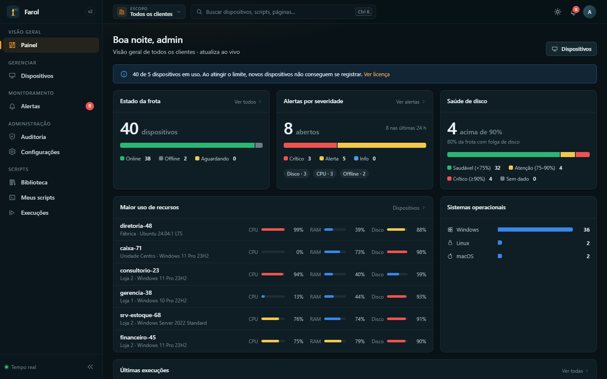
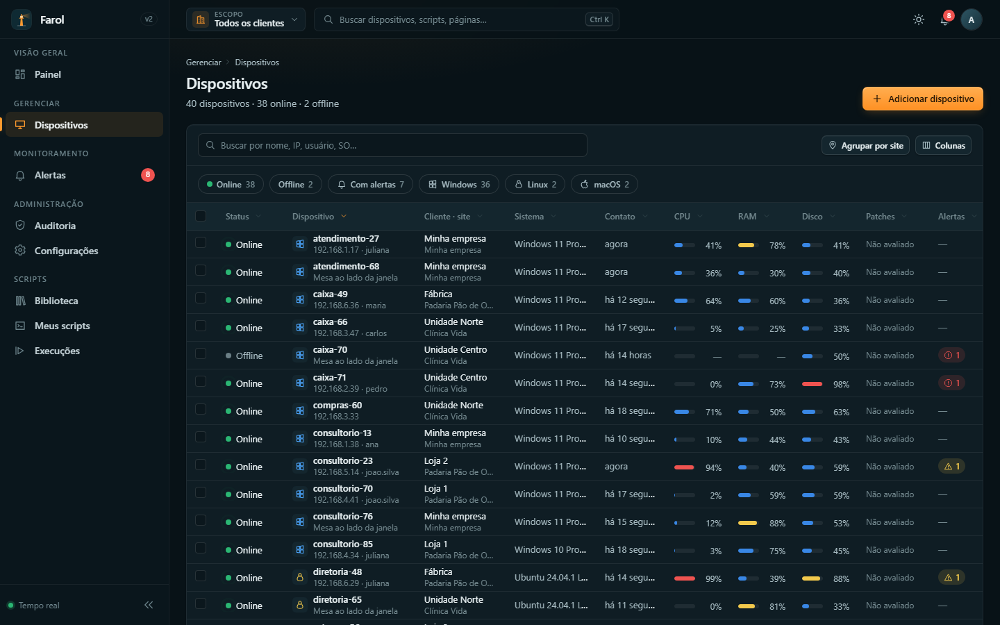
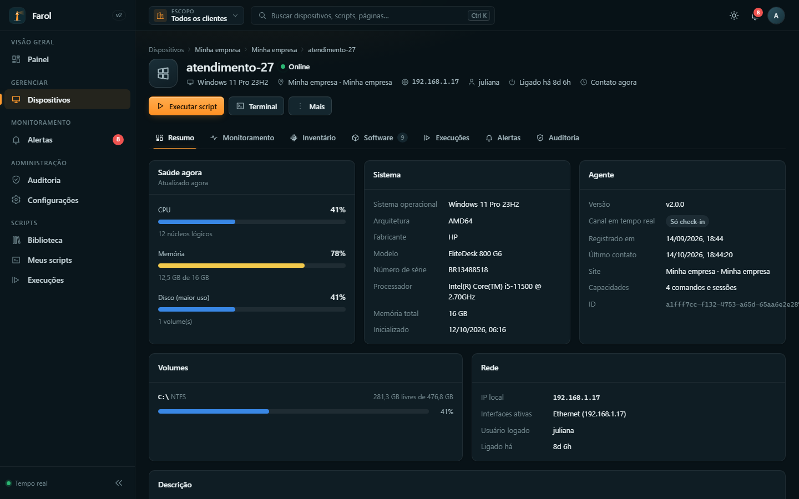
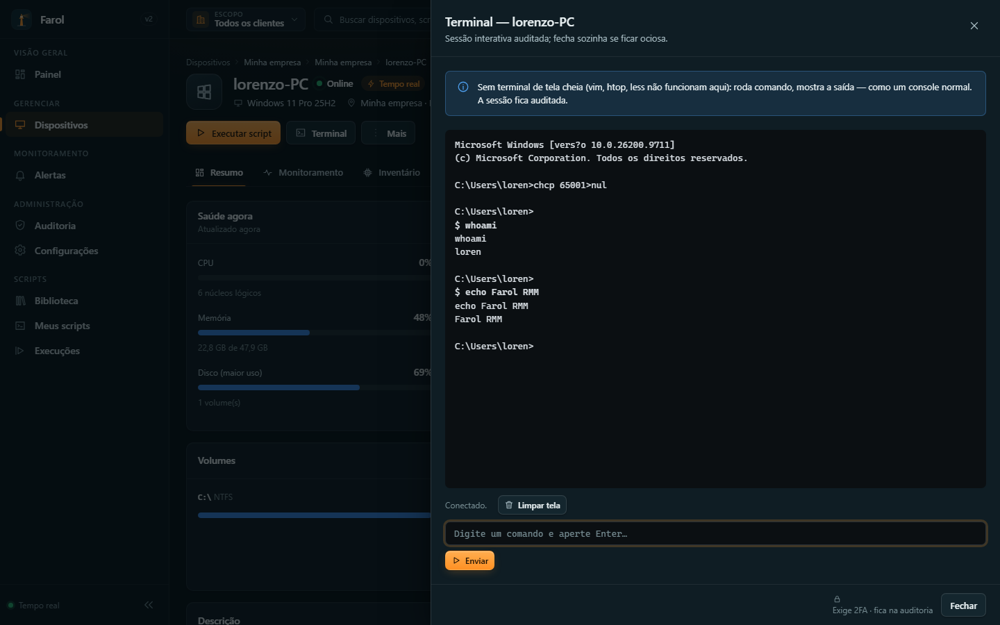
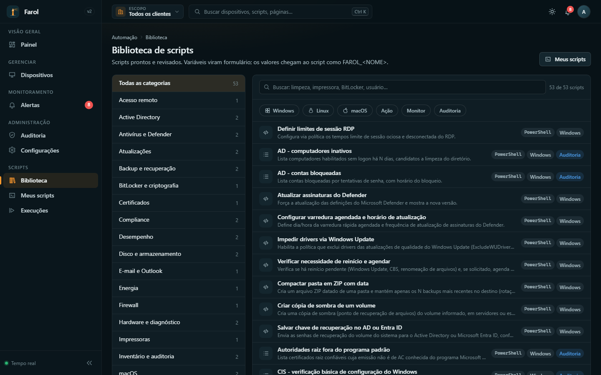
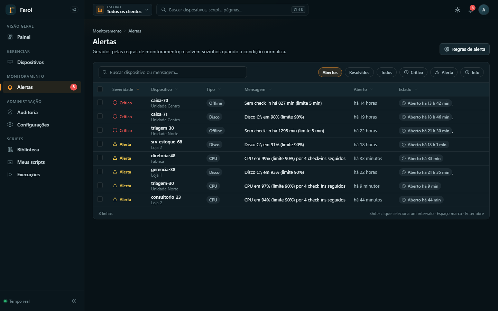

# Farol RMM — showcase

Monitoramento e gestão remota (RMM) de computadores Windows e Linux, **auto-hospedado e enxuto**: um
servidor Node.js com SQLite embutido, um painel web sem frameworks (zero React/Vue/build step) e um agente
Python de um arquivo só.

**Este repositório é a versão pública/portfólio do Farol** — código real, rodável, com os mesmos
fundamentos (design system, segurança, arquitetura modular) do produto de verdade, mas **deliberadamente
sem** as funções mais avançadas e de maior diferenciação, que ficam só no [Farol Pro](#farol-pro). Não é
uma versão "trial" ou "lite" escondida: é um projeto de código aberto genuíno, pensado pra mostrar como o
produto é construído — e pra quem quiser rodar de verdade, não só ler sobre.

Inspirado em ferramentas RMM como Tactical RMM e NinjaOne; código 100% original.

## Screenshots

### Visão geral — monitoramento em tempo real da frota



### Lista de dispositivos — busca, filtros, mini-gráficos ao vivo



### Detalhe do dispositivo — inventário, saúde, rede



### Terminal interativo remoto — shell de verdade, auditado



### Biblioteca de scripts — amostra de 53 scripts prontos



### Alertas — regras por limiar, severidade, estado



## O que tem nesta versão

- **Inventário e métricas em tempo real.** Check-in a cada 15 s (CPU, RAM, discos, uptime, usuário logado,
  IP) e inventário completo de hora em hora (hardware, rede, softwares instalados). Histórico em camadas
  com downsampling automático (1 min → 15 min → 1 h → 1 dia), gráficos de até 90 dias.
- **Painel web.** Visão geral com totais e alertas, lista de dispositivos com busca e filtros, detalhe com
  gráficos de CPU/RAM, discos, inventário em abas, histórico de execuções. Tema escuro (padrão) e claro,
  responsivo, atualização ao vivo por WebSocket.
- **Scripts remotos.** Biblioteca com uma amostra de **53 scripts** PowerShell/Bash prontos (31
  categorias — a versão completa tem 551). Execute em um ou vários dispositivos de uma vez; tempo limite,
  stdout/stderr/código de saída.
- **Alertas por limiar.** Regras globais para CPU, RAM, disco acima de X% e dispositivo offline, com
  exceções por dispositivo e janelas de manutenção (suspendem o alerta temporariamente, sem esconder —
  fica auditável). Webhook (Discord, Slack, ntfy) quando um alerta abre.
- **Terminal interativo remoto.** Sessão de shell real (PowerShell/cmd no Windows, bash/sh em Linux/macOS)
  sobre um canal em tempo real, com eco local no painel e CTRL+C de verdade. Auditada (início, fim, bytes
  trafegados), exige 2FA, fecha sozinha se ficar ociosa. Sem tela cheia (vim/htop não funcionam — é um
  console, não um emulador de terminal completo).
- **Multi-usuário e RBAC.** Convide técnicos e leitores por link (sem senha provisória), três papéis fixos
  (administrador, técnico, somente leitura), redefinição de senha por link gerado pelo admin.
- **Auditoria completa.** Logins, tokens, dispositivos registrados/revogados, scripts executados, comandos
  digitados, mudanças de regras — usuário, data, alvo e IP. Página com filtros.
- **Segurança de verdade.** Senhas com scrypt, 2FA TOTP obrigatório (QR Code gerado localmente, sem
  round-trip externo), reconfirmação por código a cada 10 min, bloqueio progressivo de login, CSRF, CSP
  restrita, tokens de instalação de uso único.
- **Modo demo.** `npm run demo` popula um banco com clientes, sites e dezenas de dispositivos fictícios
  (com 24 h de histórico, inventário e alertas) — dá pra conhecer o painel inteiro sem instalar nenhum
  agente de verdade.

## Farol Pro

O [Farol Pro](https://farol-rmm.vercel.app) é a versão completa e privada do mesmo produto, com tudo que
está aqui **mais**:

- **Automação de verdade**: jobs agendados (cron ou intervalo), resposta automática a alerta (roda um
  script sozinho quando um alerta abre), grupos dinâmicos por filtro (um dispositivo novo que bate com o
  filtro entra sozinho, sem editar nada), campos personalizados (UDFs), e políticas (um pacote nomeado de
  exceções de alerta + agendamentos, aplicado de uma vez a um site/cliente/grupo inteiro).
- **Tela remota com controle.** Vê a tela do dispositivo ao vivo e controla mouse/teclado de verdade,
  com pedido de consentimento real à pessoa na máquina (diálogo "Permitir?" antes de começar a capturar) e
  timeout de inatividade.
- **Implantação em massa.** Token de instalação reutilizável por site (uma máquina de TI do cliente roda o
  mesmo comando em 100+ computadores via GPO/Intune) e uma página pública de download com 2 cliques, pra
  mandar por e-mail/WhatsApp pra alguém não-técnico instalar sozinho.
- **Chamados de suporte com bandeja e e-mail.** Helpdesk completo: o usuário final abre um chamado pela
  bandeja do Windows (com print de tela), o técnico responde pelo painel, e — se configurado — o cliente é
  avisado por e-mail (Resend) na abertura e em cada resposta.
- **Biblioteca completa**: 551 scripts (393 Windows, 141 Linux, 21 macOS) nas mesmas 31 categorias desta
  amostra.

Essas funções nunca estiveram nesta versão pública, desde o primeiro commit — não foram "removidas" de um
produto que já era seu; é uma separação deliberada entre o projeto aberto e o produto vendido.

## Arquitetura

```
servidor/   Node.js 22+ · Fastify · SQLite (node:sqlite) · WebSocket · zero frameworks de frontend servidos
painel/     HTML/CSS/JS puro (módulos ES, sem build step), CSP restrita
agente/     Python 3.10+ (stdlib + psutil), empacotável como .pyz ou .exe (PyInstaller)
```

Cada funcionalidade do servidor é um **módulo** autocontido (`servidor/src/modulos/<nome>/index.js`):
declara suas próprias rotas, migrações de banco, permissões e tarefas periódicas, e é descoberto
automaticamente — remover um módulo (como foi feito pra montar esta versão) é literalmente apagar a pasta,
sem precisar editar nenhum registro central. O painel segue o mesmo princípio do lado do cliente.

## Como rodar

Requer Node.js 22+ e Python 3.10+.

```bash
git clone https://github.com/srlorenzos/farol-rmm.git
cd farol-rmm/servidor
npm install
npm run demo -- --dispositivos 40   # popula dados/demo.db com uma frota fictícia
DB=dados/demo.db npm start          # http://127.0.0.1:8420
```

Na primeira vez, o painel pede pra criar o usuário administrador e ativar o 2FA. Para conectar um agente de
verdade (em vez de só olhar os dados da demo), gere um token em **Dispositivos → Adicionar dispositivo** e
siga o comando mostrado — ou rode `python agente/farol_agente.py --help` direto.

### Testes

```bash
cd servidor && npm test                           # node --test
cd agente && python -m unittest discover -s testes
```

## Licença

MIT — veja [LICENSE](LICENSE). O Farol Pro é um produto comercial separado; este repositório não inclui
nenhum segredo, chave ou credencial de produção.
