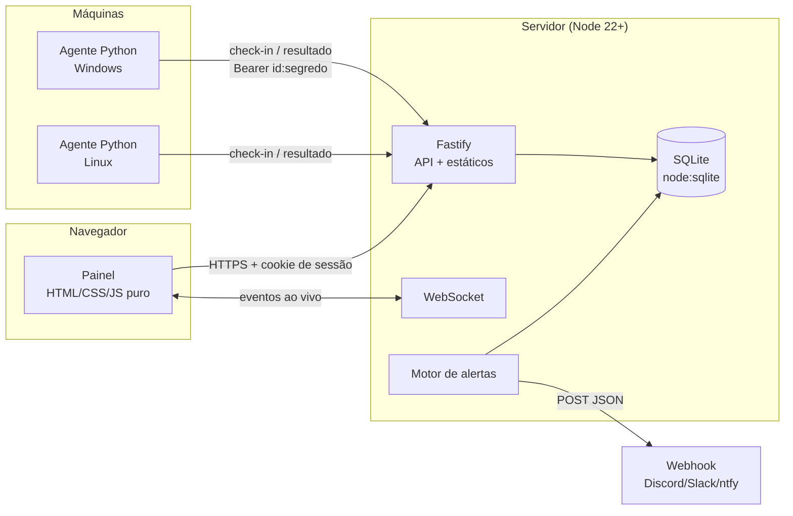

# Farol RMM

Monitoramento e gestão remota (RMM) de computadores Windows e Linux, **auto-hospedado e enxuto**: um servidor Node.js com SQLite embutido, um painel web sem frameworks e um agente Python de um arquivo só.

Inspirado em ferramentas RMM como Tactical RMM e NinjaOne; código 100% original.

## O que ele faz

- **Inventário e métricas em tempo real.** Cada agente faz check-in a cada 15 s com CPU, RAM, discos, uptime, usuário logado e IP. A cada hora envia o inventário completo: sistema, fabricante/modelo, processador, interfaces de rede com MAC e a lista de softwares instalados (registro do Windows; `dpkg`/`rpm` no Linux). O histórico fica em camadas: 1 ponto/min por 48 h, depois agregado automaticamente (médias de 15 min por 14 dias, horárias por 90 dias, diárias por 1 ano, cada balde com min/max/média/p95) — o gráfico escolhe a granularidade certa pelo período pedido (1 h a 90 dias).
- **Painel web.** Visão geral com totais, alertas e chamados abertos, lista de agentes com busca e filtros, detalhe com gráficos de CPU e RAM, discos, inventário em abas, histórico de execuções e console de comando rápido. Tema escuro (padrão) e claro, responsivo até 375 px, atualização ao vivo por WebSocket.
- **Scripts remotos.** Biblioteca de 551 scripts PowerShell, CMD, Bash e Python prontos, em 31 categorias. Execute em um ou vários agentes de uma vez; o agente roda com tempo limite, encerra a árvore de processos se estourar e devolve stdout, stderr e código de saída (até 64 KB cada).
- **Alertas.** Regras globais para CPU e RAM acima de X% por N check-ins, disco acima de X% e agente offline há mais de N minutos, com exceções por dispositivo (limite próprio ou tipo desligado) e janelas de manutenção (suprimem webhook/contagem num dispositivo, site ou cliente por um período, sem esconder o alerta — fica auditável). Os alertas abrem e se resolvem sozinhos, aparecem com contador na barra lateral e podem disparar um webhook (Discord, Slack, ntfy).
- **Bandeja do agente e chamados de suporte.** Ícone opcional na área de notificação do Windows (`farol-bandeja.exe`) com status de conexão, dados do computador e um helpdesk simples: o usuário final abre um chamado (com print de tela anexado), o técnico responde pelo painel, o usuário acompanha na mesma bandeja. Marca, contato e recursos configuráveis em Configurações.
- **Multi-usuário.** Convide técnicos e leitores por link (sem senha provisória), três papéis fixos (administrador, técnico, somente leitura), redefinição de senha por link gerado pelo admin.
- **Auditoria.** Logins (e falhas), tokens criados, agentes registrados/revogados, scripts executados, comandos digitados, mudanças de regras/exceções/janelas de manutenção e de chamados, com usuário, data, alvo e IP. Página com filtros.
- **Segurança de verdade.** Senhas com scrypt, 2FA TOTP obrigatório para executar qualquer coisa (com QR Code gerado localmente, sem round-trip a nenhum serviço externo), reconfirmação por código a cada 10 min, bloqueio progressivo de login, CSRF, CSP restrita, tokens de uso único. Detalhes em [Segurança](#segurança).

## Como é o painel

- **Login**: cartão centralizado; na primeira execução vira o formulário de criação do administrador.
- **Visão geral**: cartões de dispositivos, alertas e chamados abertos com uma faixa de cor à esquerda, a lista das máquinas com maior uso (mini barras de CPU/RAM/disco com o valor em texto) e as últimas execuções com selo de status.
- **Agentes**: tabela com caixa de busca, filtros de status e sistema, ponto verde pulsante para quem está online (sempre acompanhado do texto "Online"/"Offline"), mini barras e ações rápidas que aparecem ao passar o mouse. Marcar várias linhas abre uma barra de ações em lote para executar um script em todas.
- **Detalhe do agente**: cabeçalho com sistema, IP, usuário, uptime e último contato; abas Resumo, Monitoramento (gráficos de linha em SVG feitos à mão, 1 h a 90 dias, com linha-guia vertical e tooltip ao passar o mouse ou usar as setas do teclado, e tabela de dados alternativa), Inventário (Hardware, Rede, Softwares com busca), Execuções (console de comando rápido + histórico), Alertas (exceções e janela de manutenção do dispositivo), Chamados e Auditoria.
- **Scripts**: lista à esquerda e editor à direita com numeração de linhas. "Executar…" abre a seleção de agentes e depois a confirmação do código 2FA.
- **Chamados**: lista com filtros e ação em massa de status; tela de um chamado com conversa em linha do tempo, prints ampliáveis, dados do dispositivo e troca de status/prioridade/responsável.

## Arquitetura



```
farol-rmm/
├── servidor/        Node.js + Fastify, ESM puro, sem build
│   ├── src/         app, rotas, banco, alertas, segurança (scrypt, TOTP)
│   ├── scripts/     criar-admin.js
│   └── test/        node --test
├── painel/          SPA com rotas por hash, servida pelo servidor (sem CDN)
│   ├── css/app.css
│   └── js/          app, api, ui, gráficos SVG e uma página por módulo
└── agente/          farol_agente.py (stdlib + psutil), unit systemd e testes
```

O agente sempre **puxa** o trabalho: os jobs pendentes vão na resposta do check-in. Nada no servidor abre conexão para as máquinas, então não é preciso liberar portas nelas.

## Início rápido

**Windows, jeito mais simples:** dê dois cliques em [`iniciar-farol.cmd`](iniciar-farol.cmd). Ele instala as dependências na primeira vez, sobe o servidor, inicia o agente (se este PC já estiver registrado) e abre o painel em http://127.0.0.1:8420. Se o PowerShell disser que "a execução de scripts foi desabilitada", use `npm.cmd` no lugar de `npm` nos comandos abaixo.

### Servidor

Requer Node.js 22.13 ou mais novo.

```bash
cd servidor
npm install
npm run criar-admin            # pergunta usuário e senha
npm start                      # http://127.0.0.1:8420
```

Para automação: `npm run criar-admin -- --usuario admin --senha 'Uma-Senha-Forte-1'`. Se preferir, pule o `criar-admin` e crie o administrador na tela de primeiro acesso do painel (ela só aparece enquanto não existe nenhum usuário).

Depois de entrar, vá em **Configurações** e ative o 2FA: o painel mostra a chave secreta e a URI `otpauth://` para colar no seu aplicativo autenticador. Sem 2FA não é possível executar scripts.

Configuração por variáveis de ambiente ou `servidor/.env` (veja [`servidor/.env.exemplo`](servidor/.env.exemplo)): `PORT`, `HOST` (padrão `127.0.0.1`), `DB` (padrão `dados/farol.db`), `URL_PUBLICA`, `WEBHOOK_URL`, `SESSAO_HORAS`.

### Instaladores para Windows (.exe)

Sem Python na máquina do cliente. Os arquivos saem do GitHub Release (`releases/latest/download/<nome>`) ou do build local (`empacotamento\dist
elease\`):

| Arquivo | Para quê |
|---|---|
| `FarolAgenteSetup.exe` | Instalador com assistente (pede URL do servidor e token). É o que o técnico manda ao cliente; aparece em "Aplicativos instalados" com desinstalador. |
| `farol-agente.exe` | Agente em arquivo único, com `instalar`, `desinstalar` e `status`. |
| `farol-bandeja.exe` | Ícone da bandeja (sem console). |
| `farol-servidor.exe` | O servidor inteiro num executável, para hospedar no Windows. |
| `SHA256SUMS.txt` | Somas SHA-256 para conferir os downloads. |

**Instalação interativa:** execute `FarolAgenteSetup.exe`, informe a URL e o token do painel (Dispositivos, Adicionar agente). O Setup copia tudo para `C:\Program Files\Farol`, registra o serviço **Farol RMM Agent** (início automático, reinício em falha), registra a bandeja para iniciar com todos os usuários e inicia os dois.

**Implantação em massa (GPO, Intune, RMM):**

```powershell
FarolAgenteSetup.exe /VERYSILENT /SUPPRESSMSGBOXES /SERVIDOR=https://farol.exemplo.com.br /TOKEN=<TOKEN> /LOG=setup.log
```

O token vale uma vez só e por 24 h: para muitas máquinas, gere um por máquina (ou um por lote, dentro da validade e usando a API). Sem `/TOKEN`, o Setup só atualiza uma instalação existente e mantém a configuração. O painel já mostra esse comando na aba "Windows (Setup.exe)" do diálogo de novo dispositivo; troque a origem do download com a variável `FAROL_SETUP_URL` no servidor, se hospedar o Setup em outro lugar.

**Sem o Setup**, direto pelo exe — **precisa ser Administrador** (sem admin, ele pede elevação via UAC sozinho e espera você responder; sem ninguém pra clicar "Sim", como num script não interativo, fica esperando o prompt):

```powershell
.\farol-agente.exe instalar --servidor https://farol.exemplo.com.br --token <TOKEN>
.\farol-agente.exe status
.\farol-agente.exe desinstalar                  # pergunta se apaga %ProgramData%\Farol
.\farol-agente.exe desinstalar --manter-config  # remove tudo menos a configuração
```

O serviço é um serviço Windows de verdade, hospedado pelo próprio agente via pywin32. Isso exige o build em pasta (o que o Setup instala); o `farol-agente.exe` de arquivo único usa como plano B uma Tarefa Agendada como SYSTEM na inicialização, com reinício em falha. O instalador tenta primeiro o modo preferido (serviço, ou tarefa no exe de arquivo único) e, se falhar por qualquer motivo, **tenta o outro automaticamente**; só termina com erro (código de saída ≠ 0) se nenhum dos dois der certo — nesse caso ele nunca finge sucesso: a mensagem final explica os dois motivos e diz que nada ficará rodando até você resolver (rodar como Administrador, ou iniciar manualmente com `farol-agente.exe rodar`). Use `--modo servico` ou `--modo tarefa` para forçar um só, sem tentar o outro.

**Diagnóstico:** toda execução (instalação, remoção, `status`, `rodar`...) grava em `agente.log` na mesma pasta da configuração (`%ProgramData%\Farol\agente.log` no caso comum; cai para `%TEMP%\farol-agente.log` se não conseguir escrever ali), além do console — então uma instalação que falhou silenciosamente no console (ex.: via Setup `/VERYSILENT`, que roda escondido) sempre deixa rastro nesse arquivo.

**Servidor em um exe:** `farol-servidor.exe` extrai o painel e a biblioteca para `%ProgramData%\FarolServidor` (ou `FAROL_DADOS`), guarda lá o banco e um `.env` opcional. `farol-servidor.exe criar-admin --usuario U --senha S` cria o administrador; `instalar-tarefa` (como administrador) faz o servidor subir com o Windows. As variáveis `PORT`, `HOST`, `URL_PUBLICA` etc. funcionam como no servidor normal.

**Gerar os instaladores localmente:** Python 3.10+ com `pip install pyinstaller pywin32 psutil pillow`, Node 22+ e Inno Setup 6 (`winget install JRSoftware.InnoSetup`). Como a política de execução costuma bloquear `.ps1`:

```powershell
powershell -ExecutionPolicy Bypass -File empacotamento\build.ps1            # tudo
powershell -ExecutionPolicy Bypass -File empacotamento\build.ps1 -PularServidor -PularSetup
```

O script usa `npm.cmd`. A versão vem de `empacotamento/VERSION` (única fonte: metadados dos exes, Setup e `farol.VERSAO`). O release no GitHub sai pela tag: `git tag v2.1.0 && git push origin v2.1.0` dispara `.github/workflows/release.yml`, que publica os cinco arquivos com nomes fixos. **Assinatura de código** é opcional: com os secrets `CERT_PFX_BASE64` e `CERT_SENHA` o workflow (e o `build.ps1`, com `CERT_PFX`/`CERT_SENHA` no ambiente) assina os exes e o Setup. Sem certificado, o Windows SmartScreen e alguns antivírus podem avisar na primeira execução; confira o SHA-256.

### Agente (com Python)

Requer Python 3.10+ e `psutil` (`pip install -r agente/requirements.txt`, ou `sudo apt install python3-psutil`).

1. No painel, **Agentes → Adicionar agente** gera um token de instalação (uso único, vale 24 h) e mostra o comando pronto para Windows e Linux.
2. Na máquina:

```bash
python farol_agente.py instalar --servidor https://farol.exemplo.com.br --token <TOKEN>
python farol_agente.py rodar             # loop principal
python farol_agente.py rodar --uma-vez   # um check-in (executa jobs pendentes) e sai
```

A configuração fica em `%ProgramData%\Farol\config.json` (Windows), `/etc/farol/config.json` (Linux como root) ou `~/.config/farol/config.json`, com permissão restrita (ACL só para SYSTEM/Administradores/usuário atual; `0600` no Linux). `--config <caminho>` usa outro arquivo.

O servidor também entrega o agente em `/download/farol_agente.py`, que é o que os comandos gerados pelo painel usam.

## Como usar

### Bandeja do agente e chamados

No Windows, o instalador (`FarolAgenteSetup.exe`) já registra a bandeja (`farol-bandeja.exe`) para abrir com o usuário. Rodando do código: `python agente/farol_bandeja.py` (precisa de `pystray`, `Pillow`, `mss` e, no Windows, `pywebview` — veja `agente/requirements.txt`). Ela fala só com a API local do próprio agente (127.0.0.1:8421, token em `%ProgramData%\Farol\bandeja.token`), nunca direto com o servidor. O ícone mostra um ponto de status (verde conectado, cinza desconectado, laranja resposta não lida) e um menu com Abrir, Novo chamado, Meus chamados, Copiar dados do sistema e Sair. A janela tem abas Sistema (hardware, desempenho, ações rápidas), Chamados e Novo chamado (com print de tela anexável).

No painel, **Chamados** no menu lateral mostra a lista com contador de abertos; abra um chamado para ver a conversa, mudar status/prioridade/responsável e responder — a resposta chega na bandeja do usuário (pelo canal em tempo real, ou no próximo check-in). O detalhe do dispositivo tem uma aba **Chamados** só com os daquele computador. Em **Configurações → Bandeja do agente**, defina o nome da empresa, a cor, um ícone opcional, o contato do suporte e ligue/desligue os recursos (chamados, print, ações rápidas) por instalação.

### Usuários e papéis

Em **Configurações → Usuários e papéis** (só administrador), convide alguém por `usuario` + `papel` (`tecnico` ou `leitura`) — o convite gera um link de uso único (válido por tempo limitado) para a pessoa definir a própria senha, sem senha provisória passando por e-mail ou chat. Para redefinir a senha de alguém que esqueceu, gere outro link do mesmo jeito; o anterior é invalidado. Um administrador sempre pode tudo; técnico executa scripts e comandos (com 2FA) mas não configura o sistema; leitura só visualiza.

### Console / comando rápido

A aba **Execuções** do detalhe do dispositivo tem uma caixa de comando rápido (PowerShell, CMD, Bash ou Python) com `Ctrl+Enter` para executar — pede confirmação 2FA como qualquer execução e fica na auditoria. Um terminal interativo de verdade (sessão contínua, não comando-a-comando) já tem o relay pronto no servidor e no agente, mas ainda não tem tela no painel — o botão "Terminal" no cabeçalho do dispositivo aparece como "em breve".

### Janelas de manutenção e exceções de alerta

Pela aba **Alertas** do dispositivo, "Colocar em manutenção" suspende alertas (webhook e contagem) só naquele computador por um tempo definido — o alerta continua sendo gerado e fica auditável, só não dispara nem conta como aberto. Em **Configurações → Janelas de manutenção** fica a lista geral, com a opção de criar uma para um cliente, site ou todos os dispositivos de uma vez. Na mesma aba Alertas, "Exceções de alerta" deixa definir um limite diferente (ou desligar um tipo de alerta) só para aquele dispositivo, sem mexer na regra global em Configurações → Regras de alerta.

## Produção

### HTTPS é obrigatório

Deixe o servidor escutando só em `127.0.0.1` e coloque um proxy reverso com TLS na frente. Com [Caddy](https://caddyserver.com/) o certificado é emitido automaticamente:

```caddyfile
farol.exemplo.com.br {
	encode gzip
	reverse_proxy 127.0.0.1:8420
}
```

E no `servidor/.env`:

```ini
URL_PUBLICA=https://farol.exemplo.com.br
```

Com `URL_PUBLICA` em `https://`, o cookie de sessão ganha `Secure`, o servidor envia HSTS e passa a confiar no `X-Forwarded-For` do proxy (para o IP correto na auditoria e no rate limit). Com nginx, use `proxy_pass` com `proxy_http_version 1.1` e os headers `Upgrade`/`Connection` para o WebSocket em `/api/ws`.

O agente **recusa** `http://` para qualquer host que não seja `localhost`/`127.0.0.1`/`::1`, a menos que você passe `--inseguro` explicitamente na instalação. A verificação de certificado TLS fica sempre ligada.

### Agente como serviço

**Windows (Agendador de Tarefas, como SYSTEM, na inicialização)** — em um PowerShell como administrador, depois do `instalar`:

```powershell
New-Item -ItemType Directory -Force "C:\Program Files\Farol" | Out-Null
Copy-Item .\farol_agente.py "C:\Program Files\Farol\"
python -m pip install psutil
$py = (Get-Command python).Source
schtasks /Create /TN "Farol Agente" /SC ONSTART /RU SYSTEM /RL HIGHEST /F `
  /TR "`"$py`" `"C:\Program Files\Farol\farol_agente.py`" rodar"
schtasks /Run /TN "Farol Agente"
```

O `psutil` precisa estar instalado para o Python usado pela tarefa (instale como administrador, não com `--user`). Se não usar o instalador .exe (seção acima, que já cria o serviço), o [NSSM](https://nssm.cc/) funciona bem: `nssm install FarolAgente "C:\Python312\python.exe" "C:\Program Files\Farol\farol_agente.py rodar"`.

**Linux (systemd)** — use o arquivo [`agente/farol-agente.service`](agente/farol-agente.service):

```bash
sudo install -Dm755 farol_agente.py /opt/farol/farol_agente.py
sudo cp farol-agente.service /etc/systemd/system/
sudo systemctl daemon-reload && sudo systemctl enable --now farol-agente
journalctl -u farol-agente -f
```

Em falhas de rede o agente tenta de novo com espera exponencial (até 5 min, com variação aleatória). Se for revogado, para de executar e fica tentando a cada 5 min sem fazer nada.

### Backup

Tudo está em um arquivo SQLite (`servidor/dados/farol.db`, modo WAL). Para backup consistente com o servidor rodando: `sqlite3 farol.db ".backup farol-backup.db"`.

## Segurança

| Tema | Como é feito |
|---|---|
| Senhas | `scrypt` (N=2¹⁵, r=8, p=1, 64 bytes) com salt aleatório de 16 bytes; comparação com `timingSafeEqual`. Usuário inexistente também gasta o tempo de um scrypt, para não vazar quem existe. Senha mínima de 10 caracteres com 3 classes. |
| 2FA | TOTP (RFC 6238, SHA-1, 6 dígitos, 30 s) implementado com `node:crypto`, testado com os vetores oficiais do RFC. Tolerância de ±1 passo e **bloqueio de reuso** do mesmo código. Obrigatório para executar scripts/comandos. |
| Modo elevado | Executar exige reconfirmar um código TOTP; a confirmação vale 10 minutos por sessão. |
| Sessão | Token aleatório de 32 bytes no cookie `HttpOnly; SameSite=Strict` (+ `Secure` com HTTPS); no banco fica só o SHA-256. Expira em 12 h; logout apaga; trocar a senha derruba as outras sessões. |
| Força bruta | Rate limit global (300 req/min por IP) e de 10/min em `/api/login`, `/api/setup`, `/api/elevar` e `/api/agente/registrar`. Após 5 falhas a conta bloqueia por 1, 2, 4… até 60 min. |
| CSRF | Cookie `SameSite=Strict` **e** header customizado `X-Farol: 1` obrigatório em toda mutação do painel (formulários de outros sites não conseguem enviá-lo sem CORS, que não é habilitado). O WebSocket confere a origem. |
| Cabeçalhos | `@fastify/helmet` com CSP `default-src 'self'`, sem `unsafe-inline` (nenhum script ou estilo inline), `frame-ancestors 'none'`, `object-src 'none'`, `base-uri 'none'`, `Referrer-Policy: no-referrer`, HSTS com HTTPS. |
| Entrada | Todas as rotas têm JSON Schema no Fastify (tipos, tamanhos, enums, padrões de UUID). SQL sempre parametrizado. |
| Saída | O painel nunca usa `innerHTML` com dados: tudo é montado com `createElement`/`textContent`. Nomes de máquinas, softwares e saídas de scripts são exibidos como texto. |
| Agentes | Token de instalação de 32 bytes, uso único, expira em 24 h, guardado como SHA-256. No registro cada agente recebe ID + segredo próprios (32 bytes, só o hash fica no servidor) e se autentica com `Authorization: Bearer <id>:<segredo>`. Revogar corta o acesso na hora e cancela os jobs pendentes. Um agente só consegue ler e responder os próprios jobs. |
| Transporte do agente | Só fala com o servidor configurado (redirecionamentos são recusados), exige HTTPS fora do localhost, verificação de certificado sempre ativa. |
| Auditoria | Toda ação sensível vai para a tabela `auditoria` com usuário, horário, alvo, detalhes e IP. Comandos digitados no console são registrados (até 500 caracteres). |

Riscos que continuam sendo seus: quem tem o login + 2FA do painel executa código como SYSTEM/root em todas as máquinas — proteja a conta, o servidor e o arquivo do banco. O webhook é configurado pelo administrador e o servidor fará POST para a URL que estiver lá.

## API do agente

Todas as rotas recebem e devolvem JSON. As duas últimas exigem `Authorization: Bearer <id>:<segredo>`.

| Método | Rota | Corpo | Resposta |
|---|---|---|---|
| `POST` | `/api/agente/registrar` | `{ token, info: { hostname, so, so_versao, arquitetura, versao_agente } }` | `{ id, segredo, intervalo }` |
| `POST` | `/api/agente/checkin` | `{ metricas: { cpu, ram_usada, ram_total, discos[], uptime, usuario, ip }, info?, inventario? }` | `{ intervalo, pedirInventario, jobs: [{ id, shell, conteudo, timeout }] }` |
| `POST` | `/api/agente/resultado` | `{ job_id, codigo_saida, stdout, stderr, duracao_ms, erro?, timeout? }` | `{ ok: true }` |
| `GET` | `/download/farol_agente.py` | — | o script do agente |

Status de um job: `pendente` → `enviado` → `sucesso` / `falha` / `timeout`. Um job enviado que não volta em `timeout + 2 min` vira `expirado`.

## Testes

```bash
cd servidor && npm test                                   # 87 testes, node --test
python -m unittest discover -s agente/testes -v           # 85 testes
```

O servidor é testado com `fastify.inject` e banco em memória: hash de senha, vetores TOTP do RFC 6238 (SHA-1/256/512), login com 2FA, bloqueio progressivo, CSRF, CSP, rate limit, token de instalação (uso único, expirado, inválido), check-in autenticado e negado, ciclo completo de job, truncamento, regras de alerta abrindo e resolvendo (com exceções por agente e janelas de manutenção), webhook, auditoria, QR Code do 2FA decodificado por um leitor real, downsampling de métricas (agregação em camadas, poda que nunca perde dado não processado, rota escolhendo a granularidade certa), chamados (fluxo completo, isolamento entre agentes, anexos) e convites/redefinição de usuários. O agente é testado na coleta de métricas e inventário, execução com timeout matando a árvore de processos, truncamento, montagem do payload, recusa de `http://` não local, detecção de interpretadores disponíveis e a API local da bandeja (token, Host/Origin, CORS, rotas). O GitHub Actions roda os dois conjuntos a cada push.

## Licenças e site

**Modelo.** O servidor funciona sem licença até **5 dispositivos**. Acima disso é preciso uma chave `FAROL-<payload>.<assinatura>`: um JSON `{id, cliente, email, plano, dispositivos_max, emitida_em, expira_em}` assinado com **Ed25519** e verificado **offline** pela chave pública embutida em `servidor/src/modulos/licenca/chave.js` (nenhum acesso à internet). `dispositivos_max = 0` significa ilimitado.

- Instale em **Configurações → Licença** (só administrador). A tela mostra plano, uso (x de y dispositivos), validade e avisa 15 dias antes de vencer; na visão geral aparece um aviso discreto perto do limite.
- Vencida, a licença tem **carência de 7 dias**; depois volta ao limite de 5 para **novos registros** (dispositivos já registrados continuam). No registro acima do limite o agente recebe HTTP 402 com a mensagem do motivo.
- Emissão manual (dono): `node servidor/scripts/emitir-licenca.js --privada <licenca-privada.pem> --cliente "Nome" --dispositivos 50 --dias 365` (`--dispositivos ilimitado`, `--sem-validade`). A chave **privada nunca entra no repositório**; no site ela vive só na variável `LICENCA_CHAVE_PRIVADA`.

**Site de vendas (`site/`).** Landing em HTML/CSS/JS puro, CSP estrita, tema escuro/claro, calculadora de preços (`publico/js/precos.js` é a fonte única dos valores), funções Vercel em `api/`:

| Função | O que faz |
|---|---|
| `api/checkout.js` | cria a Stripe Checkout Session (assinatura) recalculando o preço no servidor |
| `api/webhook.js` | valida `Stripe-Signature` (corpo raw) e emite a licença em `checkout.session.completed` / renova em `invoice.paid`; guarda em `farol/licencas/` (Vercel Blob privado) |
| `api/licenca.js` | `/sucesso.html` busca a licença da sessão paga (só devolve a da própria sessão) |
| `api/contato.js` | formulário "Fale com vendas" (guarda em `farol/contatos/`; sem Blob o site abre um `mailto`) |
| `api/config.js` | informa se a compra online está ativa |

Sem `STRIPE_SECRET_KEY` (e o resto do `.env.exemplo`) os botões de compra viram "Fale com vendas". Preços: grátis até 5; R$ 9,90 por dispositivo/mês do 6º ao 50º, e faixas de R$ 7,90, 5,90 e 4,50 acima disso; anual com 20% de desconto.

Testes locais: `cd site && npm install && npm run teste` (runner com `req`/`res` falsos); `node scripts/servir-local.mjs` serve o site com as funções. **Deploy:** a CLI da Vercel recusa pastas dentro de repo git com autor noreply, então copie `site/` (sem `node_modules`) para uma pasta fora do repositório, guarde nela o `.vercel/project.json` (há uma cópia em `site/.vercel/`, ignorada pelo git) e rode `vercel deploy --prod --yes --scope coube-studio`.

## Roadmap

- Terminal interativo no painel (relay já pronto no servidor/agente) e área de trabalho remota
- Patches: listar e aplicar atualizações do Windows Update / `apt`/`dnf`
- Jobs agendados recorrentes e políticas de automação/auto-resposta
- Sites/grupos dinâmicos e descoberta automática de rede
- Notificações por e-mail e Teams/Discord nativas (hoje só webhook genérico)
- Assinatura dos scripts e atualização automática do agente

## Limitações

- Sem acesso remoto interativo de verdade: o "Terminal" no cabeçalho do dispositivo está "em breve" — o relay já existe no servidor e no agente (mesmo mecanismo usado pelo terminal de comando único e pelos chamados), falta só a tela no painel. O que existe hoje é o console de comando único (Execuções → comando rápido): manda, espera, recebe a saída — não é uma sessão contínua.
- No Windows o agente tem instalador .exe sem Python; no Linux/macOS ainda é um script Python (3.10+ e `psutil`). Comandos PowerShell no Linux só funcionam se o `pwsh` estiver instalado — o agente detecta os interpretadores disponíveis e avisa antes de mandar um script incompatível, com uma mensagem explicando como instalar o que falta. Os exes não são assinados enquanto não houver certificado.
- Jobs ficam na fila até o próximo check-in (até ~15 s de latência).
- SQLite atende bem algumas centenas de agentes, não milhares. O histórico de métricas é guardado em camadas (1 ponto/min por 48 h, depois agregado em 15 min/1 h/1 dia com retenção de 14/90/365 dias) justamente para isso — ver `ARQUITETURA.md`.
- Sites/grupos e descoberta automática de rede ainda não existem (só clientes/sites manuais).
- Sem patches do Windows Update / `apt`/`dnf`, sem políticas de automação/jobs agendados recorrentes, sem notificação por e-mail (webhook cobre Discord/Slack/ntfy).
- Convite de usuário e redefinição de senha são só por link gerado no painel (sem envio de e-mail automático — o administrador copia e manda o link).

## Licença

MIT © Eduardo Lorenzo
